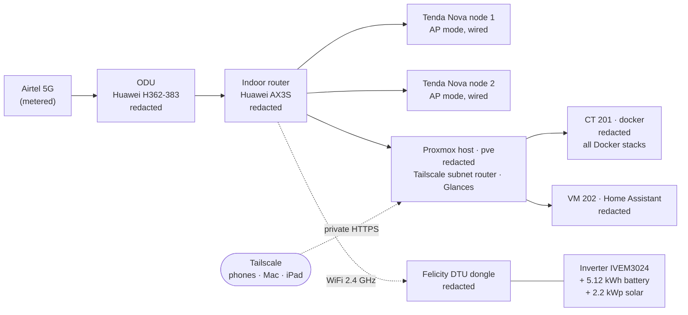
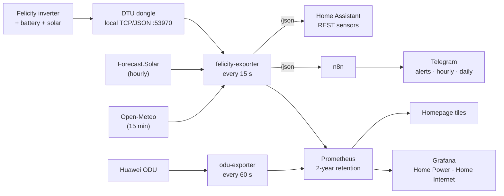

# 🏠 Homelab

A single quiet Proxmox server running media, photos, files, home automation, solar/battery monitoring and automations, all reachable privately from anywhere over Tailscale.

This repo is the **recipe**: compose files, configs, scripts and notes. It is *not* a data backup, and it never contains secrets.

> IP addresses in this document are **redacted**. The real values live in the AX3S router config, Proxmox, and the `.env` files on the server.

---

## 🖥️ Hardware

### Server

| Component | Details |
|---|---|
| Server | Dell OptiPlex 5050 **Micro**, 4 CPU cores |
| Hypervisor | Proxmox VE 9 |
| RAM | 16 GB (2 × 8 GB DDR4 SODIMM, both slots full; max 32 GB) |
| Storage | 512 GB NVMe (M.2); **2.5" SATA bay free** for expansion |
| BIOS | AC Recovery = Power On · Wake on LAN = LAN Only · VT-x/VT-d on · SATA = AHCI |
| Remote console | JetKVM Mini (planned) |

### Power system

| Component | Details |
|---|---|
| Inverter | Felicity **IVEM3024** (3 kW, 24 V hybrid) |
| Battery | Felicity **LPBF24200-M** LiFePO4: 25.6 V × 200 Ah = **5.12 kWh**, rated ≥ 6,000 cycles at 80% DoD, ≤ 2 kW recommended |
| Solar | 4 × 550 W = **2.2 kWp** |
| Monitoring | Felicity DTU WiFi dongle, read **locally** (TCP/JSON, port 53970) |
| Grid | EKEDC Band A |

---

## 🌐 Network



- Tenda nodes run in **AP mode**, so everything shares one LAN (router mode caused double NAT and Tailscale relaying).
- The AX3S DHCP pool stops short of the server range; servers and the DTU dongle have **fixed / reserved addresses** (redacted).
- **CT 201 uses public DNS** (Cloudflare and Google resolvers, set in Proxmox → 201 → DNS) and has **IPv6 disabled** (`/etc/sysctl.d/99-disable-ipv6.conf`). Both were needed for reliable Docker image pulls.

### Address plan

| Address | Use |
|---|---|
| redacted | Huawei AX3S router (gateway) |
| redacted | DHCP pool for phones, laptops, TVs |
| redacted | Proxmox host `pve.home.arpa` (UI on `:8006`, Glances on `:61208`) |
| redacted | CT 201 `docker` (all stacks) |
| redacted | VM 202 Home Assistant (`:8123`) |
| redacted | Felicity DTU dongle (DHCP reservation) |
| redacted | Huawei ODU |

---

## 🧱 Proxmox layout

| ID | Type | Resources | Disks |
|---|---|---|---|
| 201 `docker` | Unprivileged LXC (Debian 13) | 4 cores, 10 GB RAM, 2 GB swap | rootfs 32 GB (→ grow), **mp0** `/srv/data` 280 GB (media), **mp1** `/srv/photos` 100 GB (Immich) |
| 202 `homeassistant` | VM, Home Assistant OS 18.4 | 2 cores, 4 GB RAM | 32 GB on `local` |

- CT 201: `nesting` + `keyctl`, TUN allowed, `/dev/dri/renderD128` passed through (GID 992) for Intel QuickSync. **Start at boot** on for 201 and 202.
- Storage: `local-lvm` thin pool (~337 GB) holds CT 201's disks; `local` holds ISOs, templates and VM 202.
- Host extras: Tailscale subnet router (`--accept-dns=false`), **Glances** (`/opt/glances`, systemd), nightly `sync.sh` (03:00), weekly `pct fstrim 201` (Sunday 04:00).

---

## 🔐 Remote access: Tailscale

Tailnet: `tailc33d1b.ts.net`

1. **Subnet router on the Proxmox host** makes the whole LAN reachable remotely.
2. **One sidecar per web app** gives it a private HTTPS address `https://<name>.tailc33d1b.ts.net`. No router ports are open.

Public sharing (later): Cloudflare Pages for static sites; Tailscale Funnel or node sharing for specific needs.

---

## 📋 Services

LAN ports are on CT 201 (address redacted) unless noted.

### Watch & listen

| Service | Purpose | Tailnet | LAN | Stack |
|---|---|---|---|---|
| Jellyfin | Movies & TV | `jellyfin` | `:8096` | `media-stack` |
| Seerr | Requests | `requests` | `:5055` | `media-stack` |
| Audiobookshelf | Audiobooks & podcasts | `books` | `:13378` | `media-stack` |
| Navidrome | Music (Subsonic) | `music` | `:4533` | `navidrome` |
| Octo + slskd | Music discovery for Navidrome | `octo` | `:5274`, slskd `:5030` | `octo` |

### Library & files

| Service | Purpose | Tailnet | LAN | Stack |
|---|---|---|---|---|
| Immich | Photos | `photos` | `:2283` | `immich` |
| Nextcloud | Files, calendar, contacts | `cloud` | `:8091` | `nextcloud` |
| Calibre-Web Automated | Ebooks | `ebooks` | `:8083` | `calibre` |
| FileBrowser Quantum | Upload to the media library | `files` | `:8099` | `filebrowser` |
| Stirling PDF | PDF tools | `pdf` | `:8095` | `stirling-pdf` |
| Drawing Club | Kids' step-by-step drawing | `draw` | `:8097` | `drawing-club` |
| Dawarich | Location history | `map` | `:3020` | `dawarich` |

### Downloads (`media-stack`, Tailnet `arr`)

| Service | Port | Notes |
|---|---|---|
| Sonarr / Radarr / Lidarr | `:8989` / `:7878` / `:8686` | |
| Bookshelf (audio / ebooks) | `:8787` / `:8788` | Readarr revival (Hardcover metadata) |
| LazyLibrarian | `:5299` | Runs alongside Bookshelf |
| Prowlarr | `:9696` | Indexers for all of the above |
| qBittorrent | `:8080` | VPN optional (Surfshark via gluetun, `compose.vpn.yaml`) |
| Bazarr | `:6767` | Subtitles |

### Home, monitoring & system

| Service | Purpose | Tailnet | LAN | Stack |
|---|---|---|---|---|
| Homepage | Main dashboard (YAML) | `homepage` | `:3010` | `homepage` |
| Homarr | Dashboard (UI) | `home` | `:7575` | `homarr` |
| Grafana | Internet + Home Power dashboards | `grafana` | `:3000` | `monitoring` |
| Prometheus | Metrics database | via subnet router | `:9090` | `monitoring` |
| Uptime Kuma | Up/down checks + Telegram alerts | `status` | `:3001` | `monitoring` |
| felicity-exporter | Inverter metrics + `/json` | — | `:9878` | `monitoring` |
| n8n | Automations | `n8n` | `:5678` | `n8n` |
| Home Assistant | Home automation | via subnet router | VM 202 `:8123` | VM |
| Proxmox / Glances | Hypervisor / host stats | via subnet router | host `:8006` / `:61208` | host |

---

## ⚡ Energy monitoring



- **Collected:** solar, battery (SOC, V, A, W, temperature), house load, grid voltage/power/presence, inverter temperatures, warnings/faults.
- **Running totals** (saved in the `felicity-state` volume, survive restarts): solar, load, grid, battery charge/discharge energy, from which day/month/year/all-time figures are derived. "All time" = since tracking began.
- **Home Power dashboard:** live overview, runtime estimates (current draw, overnight, energy left, **time to full charge**), power flow, grid availability and hours per day, energy accounting, battery health (Ah available, equivalent cycles, temperature peaks), **financials** (savings vs grid/generator, recovered %, payback by supply mix), solar forecast and outdoor weather.
- **Settings** (`docker/monitoring/.env`): `BATTERY_CAPACITY_WH=5120`, `BATTERY_RESERVE_PERCENT=20`, `INVERTER_OVERHEAD_W=100`, `TARIFF_NGN_PER_KWH=209.50` (+ `TARIFF_VAT_PERCENT=7.5`), `GENERATOR_COST_NGN_PER_KWH=750`, `SYSTEM_COST_NGN=3000000`, `SOLAR_KWP=2.2`, `PANEL_TILT`, `PANEL_AZIMUTH`, site coordinates.

---

## 📁 Repo layout

```
homelab/
├── README.md
├── sync.sh                       # nightly Proxmox config snapshot (cron on pve, 03:00)
├── pve/  host/                   # auto-synced Proxmox + network config
├── homeassistant/
│   └── inverter-rest.yaml        # REST sensors for configuration.yaml
└── docker/
    ├── media-stack/              # Jellyfin, *arr apps, Bookshelf x2, LazyLibrarian, qBittorrent, Seerr, Audiobookshelf
    │   └── compose.vpn.yaml      # optional: qBittorrent through gluetun (Surfshark)
    ├── monitoring/               # odu-exporter, felicity-exporter, Prometheus, Grafana, Uptime Kuma
    ├── n8n/                      # n8n + workflows/ (Telegram automations)
    ├── homepage/  homarr/
    ├── immich/  nextcloud/  navidrome/  octo/  calibre/  filebrowser/  stirling-pdf/
    └── drawing-club/  dawarich/
```

### Conventions (every stack)

- `compose.yaml`, `setup-env.sh` (creates `.env`, reuses the Tailscale key from `media-stack/.env`), `tailscale/<name>.json`, `README.md`.
- App-writable folders owned by **uid 1000** (Nextcloud data: uid 33). Databases/app data in **Docker named volumes**.
- Deployed in CT 201 from a read-only clone at `/opt/homelab`.

## 🔑 Secrets policy

- Real values only on the server, in `.env` and `*.secret` files (gitignored). Homepage API keys live in `homepage.secret`.
- Never commit passwords, API keys, auth keys, device serial numbers or IP addresses.
- Keep in the password manager: n8n `N8N_ENCRYPTION_KEY`, Homarr `SECRET_ENCRYPTION_KEY`, Home Assistant backup key, Nextcloud admin, FileBrowser admin, slskd web login.
- If a secret is ever committed: rotate it first, then clean history.

---

## 🚀 Deploying / updating a stack

```bash
cd /opt/homelab && git pull
cd docker/<stack>
bash setup-env.sh            # first time only
docker compose up -d         # add --build for stacks with local images (monitoring, drawing-club)
```

Update images: `docker compose pull && docker compose up -d`.
**Pinned versions; read release notes before bumping:** Immich `v3`, Nextcloud `33` (one major at a time), Navidrome `0.64.2`, Dawarich `1.22.0`, Octo `2026.10.28`, slskd `0.26.2`, gluetun `v3.41`, FileBrowser Quantum `1-stable`, Bookshelf `hardcover`.

## 🛠️ Operations

**Graceful shutdown:** Proxmox → pve → **Shutdown** (stops VM 202 and CT 201 cleanly first).
**After a power cut:** the server powers on by itself, 201/202 start at boot, Docker restarts every container. Check: `docker ps --format "table {{.Names}}\t{{.Status}}"`.

**Storage hygiene**
- Weekly `pct fstrim 201` returns deleted space to the thin pool. Keep `local-lvm` under ~80% (`lvs`).
- Docker logs capped at 3 × 10 MB per container (`/etc/docker/daemon.json`).
- Watch CT 201's system disk (`df -h /`); clean with `docker image prune -a`.
- Deleting media: delete in Sonarr/Radarr **and** qBittorrent (hardlinks share space).

**Common fixes**

| Symptom | Fix |
|---|---|
| App restarts with permission errors | `chown -R 1000:1000 /opt/stacks/<app>`, then `docker compose up -d --force-recreate <app>` |
| "cannot join network namespace" | `docker compose up -d --force-recreate ts-<name> <app>` |
| Container can't resolve DNS | Host: `tailscale set --accept-dns=false`; CT 201 DNS = public resolvers |
| Image pulls fail over IPv6 ("network is unreachable") | IPv6 disabled + public DNS in CT 201 (see Network) |
| App sees an empty folder that has files on disk | Stale bind mount: `docker compose up -d --force-recreate <app>` |
| `CT is locked (fstrim)` | `pct unlock 201` |
| qBittorrent "IP banned" | Fix credentials, `docker restart qbittorrent` |
| LazyLibrarian/Bookshelf qBittorrent test fails (403) | qBittorrent WebUI → bypass auth for the media stack's Docker subnet |
| "wrong version number" (Uptime Kuma / curl) | Use `http://`, not `https://` |
| Homepage Jellyfin widget "Unexpected end of JSON" | `version: 2` in the widget |
| Mac browser can't reach LAN, curl can | System Settings → Privacy & Security → **Local Network** → allow the browser |
| Pasted command has `…` in a URL | Chat shortened the link; build URLs from variables |

## 🤖 Automations (n8n → Telegram)

- **Home power alerts & updates:** grid off/on (with durations), battery low (≤ 30%, re-arms at 40%), **hourly status**, **daily 21:00 summary** (grid hours, power cuts, solar/load kWh, battery low point, internet usage).
- **Daily data report** (21:00): ODU usage from Prometheus.
- **New on Jellyfin:** Sonarr/Radarr import webhook → message.

## 📶 Data-cap notes

Airtel 5G is metered. qBittorrent: seeding stops on completion, low upload limit. Immich backs up over the LAN at home. Octo previews/FLAC downloads use data. Speedtest Tracker, if added: max ~3 tests/day.

## 💾 Backups

- [x] Config: this repo + nightly `sync.sh`
- [x] Home Assistant: daily automatic backups (inside the VM)
- [ ] **Proxmox `vzdump` of CT 201 + VM 202 to external storage** (top priority, before relying on Immich/Nextcloud for only copies)
- [ ] External heartbeat (healthchecks.io) for whole-server outages

## 🗺️ Roadmap

**Done:** Proxmox · Tailscale · media stack + Lidarr + Bookshelf + LazyLibrarian · ODU usage monitoring · Felicity inverter monitoring (local) · Home Power dashboard with financials & forecast · Uptime Kuma · n8n Telegram automations · Immich · Home Assistant · FileBrowser · Calibre-Web Automated · Stirling PDF · Homepage (+ Glances) · Navidrome · Octo · Nextcloud · Drawing Club · Dawarich

**Next**
- [ ] Proxmox backups to external storage
- [ ] Grow CT 201 rootfs after fstrim
- [ ] Verify inverter grid-power field with the grid on
- [ ] Panel direction/tilt and install date for forecast and ROI accuracy
- [ ] Choose one dashboard (Homepage vs Homarr)
- [ ] Surfshark VPN for qBittorrent (and optionally slskd)

**Later:** Speedtest Tracker (3/day) · Subgen (CPU, Bazarr only) · SABnzbd (paid) · Loki logs · AdGuard Home · kids' sites via Cloudflare Pages · lazydocker

**Hardware:** 2.5" drive or NAS (UGREEN DH4300 Plus) for media + backups · RAM → 32 GB · JetKVM Mini

## 🙏 Credits

[LifeofDan-EL/homelab](https://github.com/LifeofDan-EL/homelab) · [tailscale-dev/video-code-snippets](https://github.com/tailscale-dev/video-code-snippets) · [TRaSH Guides](https://trash-guides.info) · [ha-felicity-solar-local](https://github.com/fabiomatavelli/ha-felicity-solar-local) (local protocol) · [Immich](https://github.com/immich-app/immich) · [Homepage](https://gethomepage.dev) · [Forecast.Solar](https://forecast.solar) · [Open-Meteo](https://open-meteo.com)
