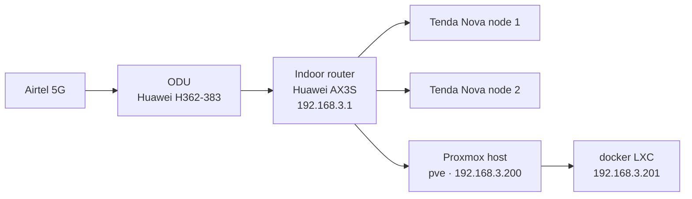

# 🏠 Homelab

My home server: a small, quiet Proxmox box that runs media, home automation and family projects, all reachable privately from anywhere over Tailscale.

This repo is the **recipe** for the homelab: configs, compose files, scripts and notes. It is *not* a backup of data (container disks and media are backed up separately), and it never contains secrets.

---

## 🖥️ Hardware

| Component | Details |
|---|---|
| Server | Dell OptiPlex 5050 **Micro** |
| Hypervisor | Proxmox VE |
| RAM | 16 GB (2 × 8 GB DDR4 SODIMM, both slots full; max 32 GB) |
| Storage | 512 GB NVMe (M.2 slot), **2.5" SATA bay free** for expansion |
| Remote console | JetKVM Mini (planned) |
| Power | Felicity inverter (BIOS set to power on after power loss) |

## 🌐 Network



### IP plan (`192.168.3.0/24`)

| Address | Use |
|---|---|
| `.1` | Huawei AX3S router (gateway + DNS) |
| `.2` – `.199` | DHCP pool for phones, laptops, TVs |
| `.200` | Proxmox host (`pve.home.arpa`), web UI on `:8006` |
| `.201` | `docker` LXC (media stack) |
| `.202` – `.254` | Reserved for future containers/VMs |

## 🔐 Remote access: Tailscale

Two layers:

1. **Subnet router on the Proxmox host** advertises `192.168.3.0/24`, so anything on the LAN (Proxmox UI, Home Assistant, the ODU and router admin pages) is reachable remotely at its normal LAN address.
2. **Sidecar containers** give each Docker app its own tailnet machine with a real HTTPS certificate, so there are no ports open on the router and no browser warnings.

| Service | Purpose | LAN | Tailnet |
|---|---|---|---|
| Proxmox | Hypervisor UI | `https://192.168.3.200:8006` | via subnet router |
| Jellyfin | Movies & TV streaming | `http://192.168.3.201:8096` | `https://jellyfin.<tailnet>.ts.net` |
| Seerr | Family request page | `http://192.168.3.201:5055` | `https://requests.<tailnet>.ts.net` |
| Audiobookshelf | Audiobooks & stories | `http://192.168.3.201:13378` | `https://books.<tailnet>.ts.net` |
| qBittorrent | Downloads (VPN optional) | `:8080` | `https://arr.<tailnet>.ts.net:8080` |
| Prowlarr | Indexer manager | `:9696` | `https://arr.<tailnet>.ts.net:9696` |
| Sonarr | TV automation | `:8989` | `https://arr.<tailnet>.ts.net:8989` |
| Radarr | Movie automation | `:7878` | `https://arr.<tailnet>.ts.net:7878` |
| Bazarr | Subtitles | `:6767` | `https://arr.<tailnet>.ts.net:6767` |

Public things (e.g. the kids' websites) will go through **Cloudflare Tunnel**, never through port forwarding. Everything above stays private to the tailnet.

## 📁 Repo layout

```
homelab/
├── README.md
├── sync.sh                     # nightly Proxmox config snapshot (cron on pve)
├── docker/
│   └── media-stack/
│       ├── compose.yaml        # Jellyfin + VPN download stack + Tailscale sidecars
│       ├── .env.example        # template; real .env is gitignored
│       └── tailscale/          # Tailscale Serve configs, one per sidecar
├── pve/                        # auto-synced: LXC/VM definitions, storage.cfg
└── host/                       # auto-synced: network config
```

## 🔑 Secrets policy

- Real values live only in `.env` files on the server, which are gitignored.
- No passwords, auth keys, VPN keys or device serial numbers in commits.
- The repo is private, but is treated as if it could leak.
- If a secret is ever committed: **rotate it first**, then clean up the history.

---

## 🚀 Setup

### 1. Tailscale account prep

In the [admin console](https://login.tailscale.com/admin):

- **DNS** → enable **MagicDNS** and **HTTPS Certificates**.
- **Settings → Keys** → generate an auth key (**Reusable ON**, **Ephemeral OFF**) and put it in `.env`.
- After each server node joins: **Machines → ⋯ → Disable key expiry**, so servers don't drop off the tailnet after the default expiry period.

### 2. Subnet router on the Proxmox host

```bash
curl -fsSL https://tailscale.com/install.sh | sh
echo 'net.ipv4.ip_forward = 1' | tee /etc/sysctl.d/99-tailscale.conf
echo 'net.ipv6.conf.all.forwarding = 1' | tee -a /etc/sysctl.d/99-tailscale.conf
sysctl -p /etc/sysctl.d/99-tailscale.conf
tailscale up --advertise-routes=192.168.3.0/24
```

Then in the admin console: **Machines → pve → Edit route settings → approve** `192.168.3.0/24`, and disable key expiry.

### 3. Create the `docker` LXC

In Proxmox: **Create CT**

| Setting | Value |
|---|---|
| CT ID / hostname | `201` / `docker` |
| Unprivileged | ✅ yes |
| Template | latest Debian standard template |
| Root disk | 32 GB (images + app configs) |
| CPU / RAM | 2–4 cores / 6 GB (swap 1 GB) |
| Network | `192.168.3.201/24`, gateway `192.168.3.1` |

Then:

- **Resources → Add → Mount Point**: 200 GB on `local-lvm`, path `/srv/data` (media + downloads; can move to an HDD later).
- **Options → Features**: tick `keyctl` and `nesting`.
- **Resources → Add → Device Passthrough**: `/dev/dri/renderD128`, *GID in CT* = render group GID inside the CT (`getent group render`). This gives Jellyfin hardware transcoding.
- Allow TUN (needed by Tailscale and gluetun). On the Proxmox host:

```bash
cat >> /etc/pve/lxc/201.conf <<'EOF'
lxc.cgroup2.devices.allow: c 10:200 rwm
lxc.mount.entry: /dev/net/tun dev/net/tun none bind,create=file
EOF
pct reboot 201
```

### 4. Install Docker and clone this repo (inside the LXC)

```bash
apt update && apt install -y curl git
curl -fsSL https://get.docker.com | sh

# Read-only deploy key for this repo (add it on GitHub WITHOUT write access)
ssh-keygen -t ed25519 -C "docker-lxc" -f ~/.ssh/github_homelab -N ""
cat ~/.ssh/github_homelab.pub
printf 'Host github.com\n  IdentityFile ~/.ssh/github_homelab\n' >> ~/.ssh/config
git clone git@github.com:<YOUR_USERNAME>/homelab.git /opt/homelab
```

### 5. Folders and permissions

Single `/data` tree so downloads → library moves are instant hardlinks (TRaSH Guides layout):

```bash
mkdir -p /srv/data/torrents/{movies,tv} \
         /srv/data/media/{movies,tv,audiobooks,podcasts} \
         /opt/stacks
chown -R 1000:1000 /srv/data /opt/stacks
```

### 6. Launch the stack

```bash
cd /opt/homelab/docker/media-stack
cp .env.example .env && nano .env
docker compose up -d
docker compose ps
```


### 7. First-run wiring

| Where | Setting |
|---|---|
| qBittorrent | Temporary admin password is in `docker logs qbittorrent`; change it immediately. Save path: `/data/torrents`. Set speed limits (data cap) |
| Prowlarr | Add indexers. FlareSolverr at `http://flaresolverr:8191`. Apps: Sonarr `http://sonarr:8989`, Radarr `http://radarr:7878` (Prowlarr server: `http://prowlarr:9696`) |
| Sonarr / Radarr | Download client: qBittorrent, host `qbittorrent`, port `8080`. Root folders: `/data/media/tv`, `/data/media/movies` |
| Bazarr | Sonarr at `sonarr:8989`, Radarr at `radarr:7878` |
| Jellyfin | Libraries: `/data/media/movies`, `/data/media/tv`. Dashboard → Playback → Transcoding → **Intel QuickSync (QSV)** |
| Seerr | Jellyfin at `http://ts-jellyfin:8096`; Sonarr `http://sonarr:8989`, Radarr `http://radarr:7878` |

Apps reach each other by **container name**. These addresses stay the same when the VPN is switched on.

### Adding the VPN later

`compose.vpn.yaml` routes qBittorrent through gluetun. To enable it, add to `.env`:

```bash
COMPOSE_FILE=compose.yaml:compose.vpn.yaml
VPN_SERVICE_PROVIDER=...      # plus WireGuard key/address for your provider
```

Then `docker compose up -d`. gluetun takes over the `qbittorrent` network name, so no app settings change. Check that qBittorrent now shows the VPN's IP, **not** your Airtel IP:

```bash
docker exec qbittorrent wget -qO- https://ipinfo.io/ip
```

### Updating

```bash
cd /opt/homelab && git pull
cd docker/media-stack && docker compose pull && docker compose up -d
```

Once everything works, pin image versions (replace `latest` with the version shown by `docker compose images`) so updates happen when *I* choose.

---

## 📶 Data-cap notes

Home internet is a metered Airtel 5G plan, and VPN + torrent traffic counts against it.

- Set **global speed limits** or the **alternative-speed scheduler** in qBittorrent (e.g. full speed only overnight).
- Prefer smaller releases (1080p over 4K remux) in Sonarr/Radarr quality profiles.
- Household usage is tracked from the ODU's traffic counters (see roadmap).

## 💾 Backups & config sync

- `sync.sh` runs nightly on the Proxmox host at 03:00, snapshots LXC/VM definitions and host network config, and pushes here only when something changed.
- Container/VM backups: Proxmox `vzdump` to an external drive *(to set up)*.

## 🗺️ Roadmap

- [x] Proxmox installed, free repos, updates
- [x] Config repo + nightly sync
- [ ] Tailscale subnet router + media stack (this compose file)
- [ ] **Internet usage dashboard**: poll the Huawei ODU (`huawei-lte-api`) → time-series DB → Grafana
- [ ] ODU signal quality + outage log, Airtel bundle forecaster
- [ ] **Inverter / grid power dashboard**: Felicity inverter data
- [ ] AdGuard Home (ad blocking, per-device DNS logs, family filtering)
- [ ] Uptime Kuma (service monitoring + alerts)
- [ ] Home Assistant (VM)
- [ ] Kids' websites via Cloudflare Tunnel
- [ ] Homepage dashboard tying it all together
- [ ] Hardware: 2.5" drive for media, RAM → 32 GB, JetKVM Mini

## 🙏 Credits

- [LifeofDan-EL/homelab](https://github.com/LifeofDan-EL/homelab): media-stack compose this is adapted from
- [tailscale-dev/video-code-snippets](https://github.com/tailscale-dev/video-code-snippets): Tailscale sidecar pattern
- [TRaSH Guides](https://trash-guides.info): folder structure and *arr best practices
